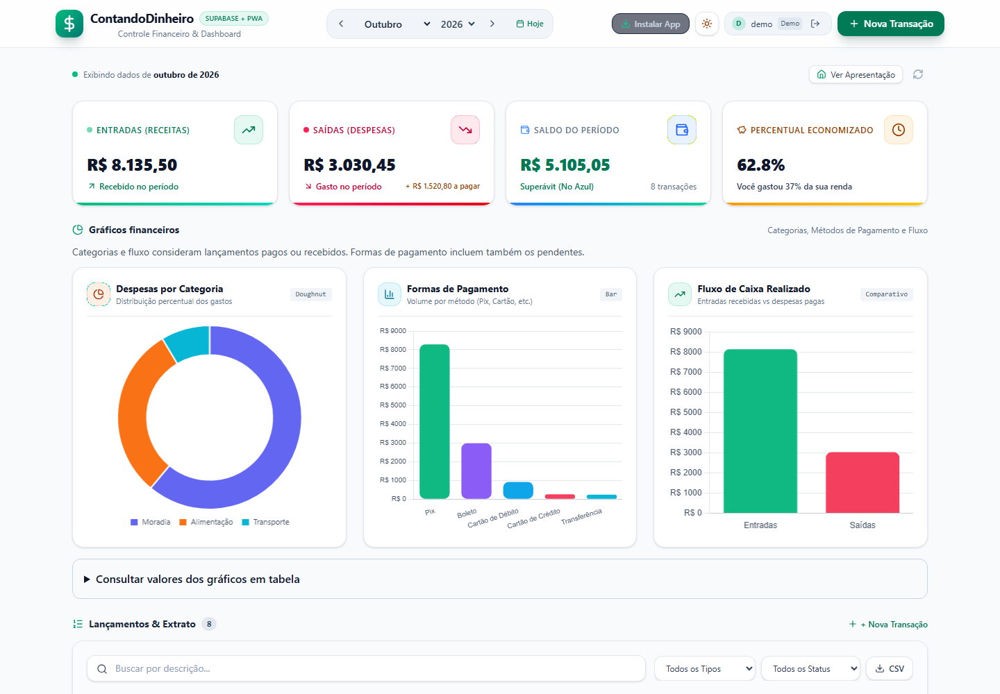
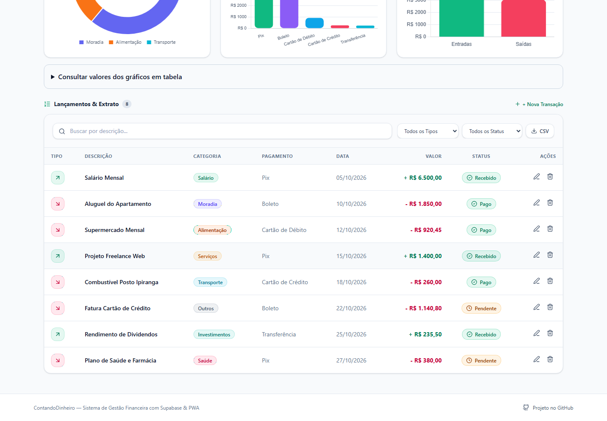
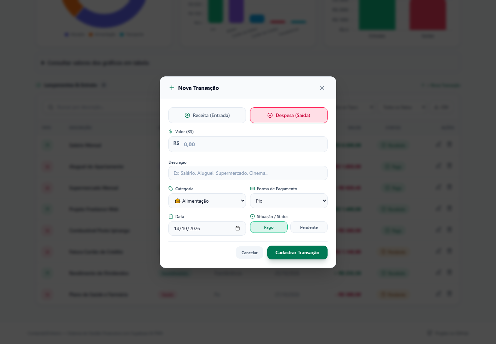
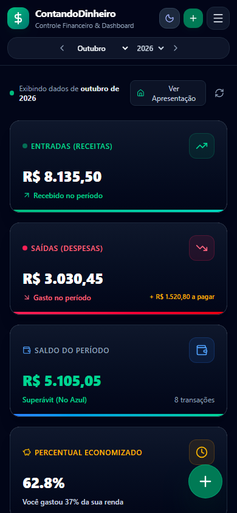

<picture>
  <source media="(prefers-color-scheme: dark)" srcset="public/branding/readme-header-dark.svg">
  <source media="(prefers-color-scheme: light)" srcset="public/branding/readme-header.svg">
  
</picture>

# ContandoDinheiro

**Finanças pessoais com clareza. Engenharia atenta aos detalhes.**

Uma aplicação web para organizar receitas, despesas e compromissos futuros, com indicadores visuais, lançamentos recorrentes e compras parceladas. O projeto reúne interface responsiva, autenticação, persistência e testes automatizados em uma experiência que pode ser explorada sem cadastro.

[**Explorar demonstração →**](https://contando-dinheiro.vercel.app/demo) · [Acessar aplicativo](https://contando-dinheiro.vercel.app/)




*As capturas desta página utilizam dados fictícios da demonstração.*

## A proposta

Quanto entrou neste mês? O que ainda falta pagar? Quanto das próximas despesas já está comprometido com parcelas? O ContandoDinheiro transforma os lançamentos do dia a dia em respostas para essas perguntas.

O painel distingue movimentações realizadas de compromissos pendentes, para que o saldo represente o dinheiro efetivamente recebido e pago. A navegação por mês ou ano permite acompanhar tanto o presente quanto os próximos compromissos.

## Explore o projeto em poucos minutos

1. Abra a [demonstração sem login](https://contando-dinheiro.vercel.app/demo), com dados fictícios prontos para explorar.
2. Consulte os indicadores e gráficos, filtre lançamentos e navegue para o próximo mês.
3. Explore contas mensais e compras parceladas, edite uma ocorrência ou marque um pagamento.
4. Exporte os resultados em CSV ou alterne entre os temas claro e escuro.

A demonstração inclui internet mensal, aulas particulares, academia com término definido, notebook em dez parcelas e curso em seis parcelas. As datas acompanham o mês de criação dos exemplos, com histórico pago e compromissos futuros pendentes.

Os dados da demonstração ficam no navegador. Para salvar seus próprios registros e acessá-los em outros dispositivos, entre com Google; o uso da conta requer conexão com a internet.

## Funcionalidades

| Recurso | O que entrega |
| --- | --- |
| **Resumo financeiro** | Receitas recebidas, despesas pagas, saldo, taxa de economia e totais a pagar e receber. |
| **Gestão de lançamentos** | Cadastro, edição e exclusão com descrição, valor, vencimento, data efetiva do pagamento, categoria, forma de pagamento e status. |
| **Pendências por vencimento** | Contas atrasadas, de hoje e dos próximos sete dias, incluindo meses anteriores e sem depender do período selecionado. |
| **Recorrências mensais** | Contas e receitas recorrentes, com ou sem data de término. |
| **Compras parceladas** | Divisão do valor total em 2 a 360 parcelas, preservando a soma exata dos centavos. |
| **Edição de séries** | Alteração de uma ocorrência ou dela e das próximas pendentes; cancelamento futuro preservando o histórico pago. |
| **Busca e filtros** | Consulta por período, tipo, status, descrição, categoria e forma de pagamento. |
| **Gráficos e exportação** | Despesas por categoria, distribuição por pagamento, comparação de receitas e despesas e exportação CSV da lista exibida. |
| **Experiência responsiva** | Interface em português, temas claro e escuro e instalação como PWA em navegadores compatíveis. |



<details>
  <summary>Veja o formulário de uma nova transação</summary>



</details>

<p align="center">
  
  <br>
  <em>O mesmo controle financeiro no celular, com opção de tema escuro.</em>
</p>

## Vencimentos e pagamentos

A data do lançamento (`data`) representa o vencimento e continua determinando o período dos resumos, gráficos e extrato. A data efetiva (`data_pagamento`) é independente e aparece no histórico e no CSV. Pagamentos antigos permanecem com data não informada; não há preenchimento retroativo presumido.

A seção de pendências reúne somente despesas pendentes, ordenadas pelo vencimento. Inclui todos os atrasos e os próximos sete dias, com totais por grupo. Registrar pagamento abre a edição com a data de hoje, que pode ser corrigida. Reabrir uma conta como pendente limpa sua data de pagamento. Cada parcela tem seu próprio registro.

A migração `20261021231121_payment_dates.sql` deve ser aplicada antes da publicação do frontend atualizado. Ela adiciona a coluna opcional, valida pagamentos e atualiza a geração de séries, preservando os dados existentes.

## Decisões de engenharia

O projeto vai além do cadastro de receitas e despesas: trata regras financeiras, limites entre dados locais e autenticados e qualidade da experiência. Alguns exemplos verificáveis no código:

| Desafio | Solução implementada | Onde explorar |
| --- | --- | --- |
| **Precisão monetária** | Somas em centavos e distribuição do restante entre parcelas, sem alterar o valor total. | [Cálculos](src/features/finance/calculations.ts) e [agendamento](src/features/finance/scheduling.ts) |
| **Datas e recorrências** | Ajuste ao último dia disponível do mês, retomando o dia original nos meses seguintes; ocorrências futuras começam pendentes. | [Regras de agendamento](src/features/finance/scheduling.ts) |
| **Consistência das séries** | Operações atômicas no banco para geração, edição e cancelamento de ocorrências. | [Migração de recorrências](supabase/migrations/20261020173827_recurring_transactions.sql) |
| **Acesso aos dados** | Autenticação com Google, políticas por proprietário no banco e registro de auditoria das alterações de transações. | [Autenticação](src/features/auth) e [migrações](supabase/migrations) |
| **Demonstração isolada** | Persistência local e bloqueio de identidades e IDs de demonstração antes do acesso autenticado. Teste de navegador exige zero requisições à API do banco durante as operações locais. | [Serviço de transações](src/features/finance/transactionsService.ts) e [teste de isolamento](e2e/demo-isolation.spec.ts) |
| **Acessibilidade** | Tabelas alternativas aos gráficos, verificações de foco e teclado e testes com axe nos temas claro e escuro, em celular e computador. | [Gráficos](src/features/finance/components/FinancialCharts.tsx) e [testes de acessibilidade](e2e/accessibility.spec.ts) |
| **Carregamento e uso offline** | Painel carregado sob demanda; a apresentação não cria dados de exemplo. A demonstração tem teste de recarga offline após o primeiro acesso. | [Entrada da aplicação](src/App.tsx) e [teste offline](e2e/production/demo-offline.spec.ts) |
| **Exportação CSV** | Tratamento de textos que poderiam ser interpretados como fórmulas por planilhas. | [Exportação](src/features/finance/csv.ts) |

### Organização do código

A aplicação separa funcionalidades de domínio, componentes de interface e serviços de infraestrutura:

```text
src/
├── features/
│   ├── auth/        # Sessão, autenticação e interface de acesso
│   └── finance/     # Cálculos, recorrências, dados locais e componentes financeiros
├── components/      # Elementos compartilhados e apresentação
├── context/         # Tema da aplicação
├── hooks/           # Conectividade e instalação da PWA
└── services/        # Integração com Supabase e armazenamento
supabase/migrations/ # Evolução do banco e políticas de acesso
e2e/                 # Fluxos de navegador, acessibilidade e versão compilada
scripts/             # Testes de regras, segurança e autenticação
```

A avaliação de manutenção, as melhorias aplicadas e as convenções para novas alterações estão em [Qualidade do código](CODE_QUALITY.md).

### Tecnologias

- **React e TypeScript:** interface baseada em componentes e contratos tipados.
- **Tailwind CSS e Chart.js:** apresentação responsiva e visualização dos dados financeiros.
- **Supabase e PostgreSQL:** autenticação, persistência, políticas de acesso e operações de séries.
- **Vite e vite-plugin-pwa:** desenvolvimento, compilação e recursos de instalação e cache.
- **Node.js Test Runner, PGlite, Playwright e axe:** testes de regras, operações SQL locais, fluxos de navegador e verificações automatizadas de acessibilidade.
- **Vercel:** hospedagem da aplicação.

## Qualidade e testes

As verificações cobrem regras financeiras, validação, recorrências, dados de demonstração, segurança e navegação de autenticação. Os testes de recorrência também exercitam as operações SQL em PostgreSQL local via PGlite. Os fluxos com Playwright verificam a experiência no navegador, incluindo isolamento da demonstração e acessibilidade.

| Comando | Verificação |
| --- | --- |
| `npm test` | Regras e serviços, incluindo cálculos, recorrências e segurança. |
| `npm run test:e2e` | Fluxos de interface no navegador. |
| `npm run test:e2e:production` | Compilação e testes da versão compilada, incluindo recarga offline da demonstração. |
| `npm run lint` | Tipagem TypeScript e análise estática com ESLint. |
| `npm run build` | Compilação para produção. |

### Integração contínua

O fluxo `.github/workflows/ci.yml` verifica pushes e pull requests em Ubuntu,
com Node 24.18.0 (fixado em `.node-version`) e a versão de npm declarada em
`packageManager`. A instalação usa `npm ci` e o `package-lock.json` versionado.

São executados análise estática, testes de regras e serviços, testes de navegador
em Chromium e `test:e2e:production`, que compila uma única vez e verifica a recarga
offline com o service worker real. O CI instala o navegador e suas dependências
de sistema. Os testes usam simulações e PGlite, sem secrets ou credenciais de
produção; as variáveis de conexão ficam vazias.

Em falhas de navegador, o artefato `playwright-diagnostics` mantém relatórios HTML,
traces e capturas por sete dias. Falhas de análise, instalação ou regras aparecem
nos logs da etapa correspondente. Execuções antigas da mesma referência são
canceladas quando uma nova começa. O fluxo tem apenas permissão de leitura do
repositório e não publica a aplicação.

## Autor e contribuições

Desenvolvido por [Jonas Nunes](https://github.com/jonasnunees). O ContandoDinheiro apresenta a integração entre desenvolvimento de interface, modelagem de regras de negócio, persistência e testes em um produto utilizável.

Sugestões e contribuições são bem-vindas: abra uma [issue](https://github.com/jonasnunees/ContandoDinheiro/issues) ou envie um pull request.

## Licença

Disponível sob a [licença MIT](LICENSE).
